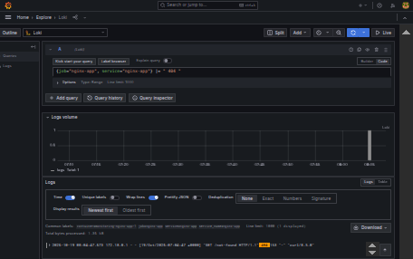

# DevOps Intern Final

[](https://github.com/Tunesky34/devops-intern-final/actions/workflows/ci.yml)

**Author:** Sodiq Kareem Babatunde

**Submission date:** 19 October 2026

**Release:** `v1.0.0`

## Architecture

```text
Source (feature branch / PR)
          |
          v
GitHub Actions: lint -> build -> test
          |
          v
GHCR: commit-SHA and latest image tags
          |
          v
Nomad client ---- registers/checks service with Consul
          |
          v
NGINX stdout/stderr -> Promtail -> Loki -> Grafana Explore
```

The same Docker image built and tested by CI is published to GHCR and consumed
by the Nomad job. NGINX writes access and error logs to the container streams;
Promtail discovers Docker containers, labels the NGINX stream, and sends it to
Loki.

## Prerequisites

Use these pinned reference versions for a reproducible assessment environment:

| Tool | Version |
| --- | --- |
| Docker Engine | 27.3.1 |
| Docker Compose plugin | 2.29.7 |
| Nomad | 1.9.3 |
| Consul | 1.20.2 |
| ShellCheck | 0.10.0 |
| Hadolint | 2.12.0 |

Docker and Compose are needed for the application and logging stack. Nomad and
Consul are needed for deployment. The CI workflow uses ShellCheck 0.10.0 and
Hadolint 2.12.0.

## Quick Start

From a machine with Docker installed:

```sh
git clone https://github.com/Tunesky34/devops-intern-final.git
cd devops-intern-final
docker build --build-arg BUILD_SHA="$(git rev-parse --short HEAD)" -t nginx-app:local ./app
docker run --rm --detach --name nginx-app -p 8080:8080 nginx-app:local
./scripts/healthcheck.sh
```

Open <http://localhost:8080>. Stop the detached container with
`docker stop nginx-app`.

## Task 1 — Source control

The public repository is
<https://github.com/Tunesky34/devops-intern-final>. The initial implementation
was merged through [PR #1](https://github.com/Tunesky34/devops-intern-final/pull/1).
These acceptance fixes were developed as separate conventional commits on a
`feature/*` branch and are delivered for review as a follow-up pull request.
The final release is tagged `v1.0.0`.

Useful verification commands:

```sh
git log --oneline --graph --decorate
git tag --list
```

## Task 2 — Linux scripts

Both scripts use POSIX `sh`, are executable in Git, and report clear failures.
POSIX `sh` does not define `pipefail`; the scripts use `set -eu` rather than
relying on a non-portable shell option.

```sh
shellcheck -s sh scripts/*.sh
./scripts/sysinfo.sh
./scripts/healthcheck.sh http://localhost:8080
```

The system report includes the current user and effective UID, hostname,
kernel, ISO-8601 date, memory, human-readable disk usage, and Docker daemon
availability. A sample from this host:

```text
Current user: tunesky
Effective UID: 1000
Hostname: tunesky-HP-EliteBook-840-G3
Kernel: Linux 7.0.0-38-generic
Architecture: x86_64
System date (ISO-8601): 2026-10-19T07:56:51+0100
Docker daemon: running
```

The health check requires exactly HTTP 200 and defaults to
`http://localhost:8080`.

## Task 3 — Containerization

The image uses the pinned `nginxinc/nginx-unprivileged:1.27-alpine` base,
serves on port 8080 as a non-root user, exposes `/healthz`, and embeds the
`BUILD_SHA` build argument in the page.

Build and run:

```sh
docker build --build-arg BUILD_SHA="$(git rev-parse --short HEAD)" -t nginx-app:local ./app
docker images nginx-app:local
docker run --rm --detach --name nginx-app -p 8080:8080 nginx-app:local
curl --include http://localhost:8080/
curl --include http://localhost:8080/healthz
```

The local image built during acceptance verification was **48,252,976 bytes**
(46.0 MiB; Docker 29.8.2 reports 48.3MB in `docker images`). It reported
runtime user `101` (`nginx`) and
exposed `8080/tcp`. Since port 8080 was already occupied on the test host, the
container was published on host port 18080 for this check:

```text
$ docker images nginx-app:acceptance-check
IMAGE                        ID             DISK USAGE   CONTENT SIZE   EXTRA
nginx-app:acceptance-check   ff0b2d052166       48.3MB             0B
$ curl --silent --output /dev/null --write-out '%{http_code}\n' http://localhost:18080/
200
$ curl --include --silent --show-error http://localhost:18080/healthz
HTTP/1.1 200 OK
Server: nginx/1.27.5
Date: Mon, 19 Oct 2026 07:31:53 GMT
Content-Type: text/plain
Content-Length: 8
Connection: keep-alive

healthy
```

A missing path returned HTTP 404, and the health-check script correctly
rejected it. On a clean host, use the documented `-p 8080:8080` mapping.
Stop the detached container with `docker stop nginx-app`.

## Task 4 — Continuous integration and publishing

The workflow runs on pull requests targeting `main` and pushes to `main`.
Separate `lint`, `build`, and `test` jobs are required before the `publish` job.
The test job downloads and runs the exact image artifact from the build job,
checks `/healthz` and `/`, and verifies a missing path returns 404. On pushes
to `main`, publish logs in using the least-privilege `GITHUB_TOKEN` and pushes
both `ghcr.io/tunesky34/devops-intern-final:<commit-sha>` and `:latest`.

Inspect the badge above or list runs with:

```sh
gh run list --repo Tunesky34/devops-intern-final --branch main
```

The original workflow passed before these acceptance fixes. The new lint,
build, test, and publish jobs are exercised by the pull request and subsequent
main-branch run; check the badge for their current status.

## Task 5 — Nomad deployment

The job registers an HTTP check with Consul, uses a dynamic `http` port mapped
to container port 8080, and includes rolling update, auto-revert, restart, and
reschedule policies. Its image tag is an HCL variable.

After the CI publish job has completed and the Nomad client can reach Consul:

```sh
nomad job validate nomad/nginx-app.nomad.hcl
nomad job plan -var="image_tag=<commit-sha>" nomad/nginx-app.nomad.hcl
nomad job run -var="image_tag=<commit-sha>" nomad/nginx-app.nomad.hcl
nomad job status nginx-app
```

Replace `<commit-sha>` with the commit SHA whose image was published to GHCR.
The production job file was validated and planned with Nomad 1.9.3. For
integration testing, a local Consul 1.20.2 dev agent and a host Nomad 1.9.3
dev agent were started. Because this branch's GHCR image is not published
until the main-branch workflow runs, the allocation test used a temporary
copy of the job with only the image reference changed to the locally built
`nginx-app:local-compose` image. The checked-in job file and its deployment
policies were not changed for this test.

```text
Job validation successful

Deployment status: successful
Task Group  Desired  Placed  Healthy  Unhealthy
web         1        1       1        0

Allocation deployment health: healthy
GET /healthz: HTTP 200 (healthy)
GET /: HTTP 200
```

The dynamic allocation port was registered in Consul under `nginx-app`.
This verifies scheduling, the Docker task, the HTTP health endpoint, and
Consul registration with the local image. After the main-branch publish
workflow completes, repeat the run with its published commit-SHA image to
verify GHCR access and deployment of that exact artifact.

## Task 6 — Loki log aggregation

On a Linux Docker host using the `json-file` logging driver, start the app,
Loki, Promtail, and Grafana together:

```sh
cd monitoring
docker compose up --build -d
docker compose ps
curl --fail http://localhost:3100/ready
curl --fail http://localhost:3000/api/health
curl --include http://localhost:8080/not-found
```

If host port 8080 is occupied, start Compose with
`APP_PORT=18080 docker compose up --build -d` and use port 18080 in the curl
command.

Grafana Explore is at <http://localhost:3000> (`admin` /
`dev-only-change-me`, local development only). The Loki datasource is
provisioned automatically. In Explore, select Loki and run:

```logql
{job="nginx-app", service="nginx-app"} |= " 404 "
```

Promtail uses Docker service discovery, labels the stream with `job`,
`container`, and `service`, and reads the NGINX Docker JSON log file. The
verified `/not-found` request returned HTTP 404 and produced this Loki stream:

```text
{"container":"monitoring-nginx-app-1","job":"nginx-app","service":"nginx-app"}
GET /not-found HTTP/1.1" 404 153
```



Stop the stack with `docker compose down`. Persistent Loki/Grafana data is
removed only with `docker compose down --volumes`.

## Troubleshooting

- **The initial health endpoint returned 404 on `/healthz`.** The original
  NGINX config served `/health`; the NGINX route, Docker health check, CI test,
  and Nomad check now use `/healthz`. The health-check script's default URL is
  `/`, and the CI/Nomad probes pass `/healthz` explicitly.
- **A push containing the workflow was rejected for missing token scope.** The
  GitHub credential needed the `workflow` scope. Refresh authorization with
  `gh auth refresh -h github.com -s repo,workflow`.
- **The local monitoring stack could not bind host port 8080.** A service
  already occupied it; starting Compose with `APP_PORT=18080` resolved the
  conflict. Loki also needed time to become ready before accepting queries.

## Known Limitations

- The Nomad job has a verified healthy local-image allocation. The GHCR
  commit-SHA image is published only after merge to `main`; its registry pull
  and deployment still need verification after that workflow completes.
- The main-branch CI must complete before claiming GHCR image publication.
  Ensure the resulting package is public or configure registry credentials
  for the Nomad client.
- Promtail requires access to the Docker socket and host container-log
  directory; this local setup is not suitable as-is for a hardened production
  environment. Promtail is also a single-instance collector.
- Grafana's credentials are intentionally development-only. Production should
  use managed secrets, authentication, TLS, durable/secured storage, and
  restricted network access.
- The sample Loki setup uses filesystem storage and single-replica operation;
  it is for local assessment/testing, not highly available production.
- Promtail can only collect logs from the Docker host where it runs; the
  separate Nomad client needs its own collector/configuration to ship
  allocation logs into Loki.

## Screenshots

The verified Grafana Explore 404 query is shown above. Add deployment
screenshots to [`docs/screenshots/`](docs/screenshots/) after running the job
in the assessment cluster.
